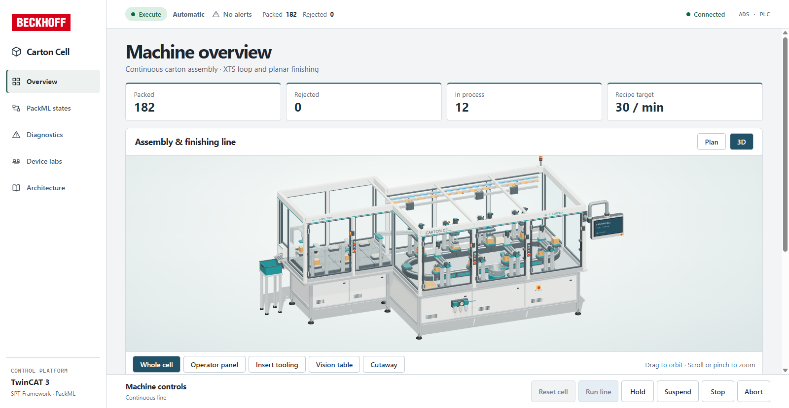

# Carton Cell

Carton Cell is a virtual carton assembly and packaging machine by **Sergio Gallegos**. Its TwinCAT PLC code has been tested on a physical Beckhoff CX50x0. The PLC controls the sequence, tracks each carton and reports inspection results to the web HMI over ADS. The complete demo can also run on a PC.

The machine model simulates ten XTS carts, eight pick-and-place stations with paired servo axes, and six XPlanar movers for inspection and final packing. All HMI commands operate these virtual mechanisms. A separate five-station bench supports single-carton and manual exercises.

| Test mode | Machine source | What runs |
| --- | --- | --- |
| HMI only | Simulation | React and the local C# model on the PC. No TwinCAT installation required. |
| HMI + local TwinCAT | ADS | The same web app reads the CartonPLC application executing in a TwinCAT runtime on the engineering PC. |
| HMI + PLC target | ADS | The web app runs on the PC and reads CartonPLC on a selected test PLC over a trusted ADS route. The mechanisms still run as software models. |

In the main Carton Cell solution, the XAE project tree contains the PLC task and application. The XTS, servo and XPlanar labels on the HMI identify simulated mechanisms. The project has no native motion axes or mapped field outputs.



### Watch the physical PLC run the virtual cell

Both clips were recorded from the React HMI while CartonPLC ran on a physical Beckhoff CX50x0. The C# service read live feedback over ADS. A separate timed run counted 30 good simulated cartons at final discharge in 59.953 seconds. [Commissioning results](docs/commissioning.md#observed-two-second-cycle)

| Clip | Screenshots from the same run |
| --- | --- |
| [Production and inspection · 19 s, MP4](docs/media/cx-production.mp4) | [Carton flow and counters](docs/images/cx-production.png) · [Assembly feedback](docs/images/cx-assembly.png) · [Planar inspection](docs/images/cx-planar.png) |
| [3D machine tour · 20 s, MP4](docs/media/cx-machine-tour.mp4) | [Guarded cell](docs/images/cx-guarded-cell.png) · [Insert tooling cutaway](docs/images/cx-insert-tooling.png) |

## Why build the cell before buying hardware?

Can the machine keep track of a carton through assembly, inspection and a handoff while other cartons stay in motion? This personal project brings together machine-building experience, industrial controls and software architecture to test that question on a laptop. To see the design in action, follow one carton ID to discharge. Then jam the insert clamp and observe which object detects the missing feedback, which layer requests a PackML abort and how the operator recovers.

The **Architecture** tab traces a command from React and TypeScript through ASP.NET Core, compares the portable plant with the TwinCAT ADS.NET path, and explains how the Structured Text function blocks collaborate. Its hardware migration view identifies the configuration, devices and measurements needed for physical commissioning. Codex assisted with implementation, debugging, test automation and documentation. Engineering judgment governs the requirements, design choices and interpretation of the results.

The portable demo runs without a TwinCAT installation. For the separate PC-based TwinCAT exercises, basic PLC engineering is free, and many TwinCAT functions offer renewable seven-day trial licenses for engineering and laboratory use. Check the selected function and target when preparing a lab. [Beckhoff engineering licensing](https://infosys.beckhoff.com/content/1033/tc3_licensing/179888523.html) · [Beckhoff TwinCAT licensing](https://www.beckhoff.com/en-en/products/automation/twincat/twincat-3-licensing/)

## Start the HMI in one of three modes

Install a .NET 10 SDK, Node.js 22 with npm, and a browser. Build the web assets once from the repository root.

```sh
npm --prefix web ci
npm --prefix web run build
```

### 1. HMI only

Start the web service and its C# machine simulator in one process.

```powershell
dotnet run --project server -- --Machine:Source=Simulation
```

### 2. HMI with TwinCAT on this PC

Open `plc/CartonCell.sln` in XAE, select the **local runtime**, resolve the PLC libraries, and build CartonPLC. Activate the configuration on that local test runtime, log in to CartonPLC, download it and start the PLC application. Record the six-field AMS Net ID from the selected target. For a Usermode Runtime, start that instance and use its own target Net ID. [PLC setup and libraries](docs/commissioning.md) · [Beckhoff Usermode Runtime startup](https://infosys.beckhoff.com/content/1033/tc170x_tc3_usermode_runtime/16309329035.html)

```powershell
$localNetId = Read-Host 'AMS Net ID of the local TwinCAT runtime selected in XAE'
dotnet run --project server -- --Machine:Source=Ads --Machine:AmsNetId=$localNetId --Machine:Port=851
```

### 3. HMI with TwinCAT on a PLC target

Keep the web service on your engineering PC. In XAE, establish an authorized ADS route with the intended test PLC, select that target and its platform, build, activate, download CartonPLC and start it there. Activation can replace the target configuration. Use a designated test PLC. Enter **the target PLC’s** AMS Net ID when launching the web service. [Target commissioning](docs/commissioning.md)

```powershell
$plcNetId = Read-Host 'AMS Net ID of the test PLC selected in XAE'
dotnet run --project server -- --Machine:Source=Ads --Machine:AmsNetId=$plcNetId --Machine:Port=851
```

Run one host on port 5080 at a time. Stop your previous host with Ctrl+C when switching. For either ADS mode, verify **Connected · ADS · PLC** in the header. In XAE, watch `GVL_HMI.Status[0]` for protocol **51003** and `GVL_HMI.Status[9]` for an advancing scan heartbeat. The target Net ID determines whether the PLC code runs locally or remotely. An unavailable ADS source appears offline.

### Exercise the cell

Open [the operator console](http://127.0.0.1:5080) and check the PackML state in the header. The default profile is **Continuous line**.

1. A fresh simulator starts in **Stopped**. If a freshly started PLC shows **Aborted**, select **Clear abort** in the bottom **Machine controls** and wait for **Stopped**.
2. From **Stopped**, select **Reset cell** and wait for **Idle**.
3. Select **Run line** and confirm the header reaches **Execute**. With the Standard recipe, the first packed carton appears after about 23 seconds. Once the line fills, the target is one good carton every two seconds. [Measured results for all three modes](docs/commissioning.md#observed-two-second-cycle)

Select a mover to see its carton ID and inspection masks. Select **3D** to orbit the guarded cell. **Operator panel** frames the suspended touchscreen, its corner mount and the local post controls. **Insert tooling** and **Vision table** use a cutaway to expose the moving mechanisms. Use **Cutaway** to switch the guarding layer in any camera view. Switch to **Device labs** to read all eight axis pairs or the six planar mover coordinates. The live status header and machine controls stay visible across tabs. Closing the browser leaves the selected machine source running.

| Try it | What to observe |
| --- | --- |
| Hold and Resume | Every cart, cam and workpiece freezes and resumes from the same master phase. |
| Simulate a missing seal | In Diagnostics select **Remove seal**. Cartons inspected at the planar camera carry the failure through final packing. Restore the fixture and observe subsequent good cartons. |
| Jam a clamp | Select **Jam insert clamp**. On a demanded ST-03 extension, F02 trips after 150 ms of missing feedback. Acknowledge that occurrence and remove the obstruction, then Clear and Reset. |
| Change recipe | Stop, select **Precision**, Reset, Run. The pitch stays at 2 s and the Z stroke increases from 40 to 48 mm. The production totals survive the change. |
| Exercise one station | While Stopped select **Single-carton bench** or **Manual bench**. The older five-station model, manual strokes and PackML Complete path are available here. [Bench commissioning exercises](docs/commissioning.md#single-carton-bench-acceptance) |
| Export a report | Run `python scripts/line_report.py --seconds 30` against the local service. Open the resulting CSV or query the SQLite samples and events. |

## Control and motion

The automatic line runs a 10 ms virtual scan. Eight two-axis servo pairs follow a common electronic cam. ST-06 follows its moving cart during insertion. A virtual pneumatic clamp reports stroke feedback independently of its command. Each product carries eight assembly check bits, a planar verification bit and a vision bit. One transfer moves the product identity and its results together. Final packing consumes the identity once and increments the appropriate counter.

The default C# plant and optional TwinCAT Structured Text implementation expose the same snapshot. In ADS mode the PLC owns the SPT/PackML state, permissives, motion and counts. ASP.NET Core serializes requests and reads the 424-byte status image. React and TypeScript render feedback, diagnostics, a sampled servo scope and production metrics. The simulated rates describe the model. Actual motion, payload, clearance, camera exposure and real-time performance require engineering on a selected target.

## Engineering and verification

| Resource | What it contains |
| --- | --- |
| [Architecture](docs/architecture.md) | PLC OOP ownership, cam timing, workpiece identity, inspection, OEE and extension points |
| [ADS contract](docs/ads.md) | Protocol 51003, complete word layout, command IDs and occurrence-aware acknowledgments |
| [Commissioning](docs/commissioning.md) | Laptop acceptance, optional XAE/XAR or Beckhoff test PLC and troubleshooting |
| [Mechanical package](docs/mechanical.md) | Native FreeCAD/Blender models, glTF asset, dimensioned layout and official STEP references |
| [Native Beckhoff labs](docs/device-labs.md) | NC axes, XTS, XPlanar and TwinCAT Vision File Source exercises |
| [Task board](docs/board.md) | Delivered work, verification evidence, open engineering tasks and human/agent handoff |
| [Project guide](AGENTS.md) | Contribution workflow and subsystem ownership |

```sh
python scripts/verify_contract.py
dotnet run --project tests/LineBench
# Run these against a fresh local simulation host, in order.
python scripts/smoke_line.py --measure-rate
python scripts/smoke.py
```

The deterministic benchmark exercises 60,000 scans, carton conservation, flying synchronization, Hold, reject, recovery and recipe changes. The HTTP tests use the same requests as the HMI. With a local ADS router, `dotnet run --project tests/AdsLoopback` tests the real transport against an isolated synthetic peer. To check the active simulator or PLC, run `python scripts/measure_rate.py` during uninterrupted continuous production with a good seal. It measures 30 good-carton intervals at the HMI endpoint using elapsed wall-clock time. Local PLC commissioning evidence is recorded on the task board.

[MIT license](LICENSE) · [Beckhoff, SPT Framework and PackML notices](NOTICES.md)
