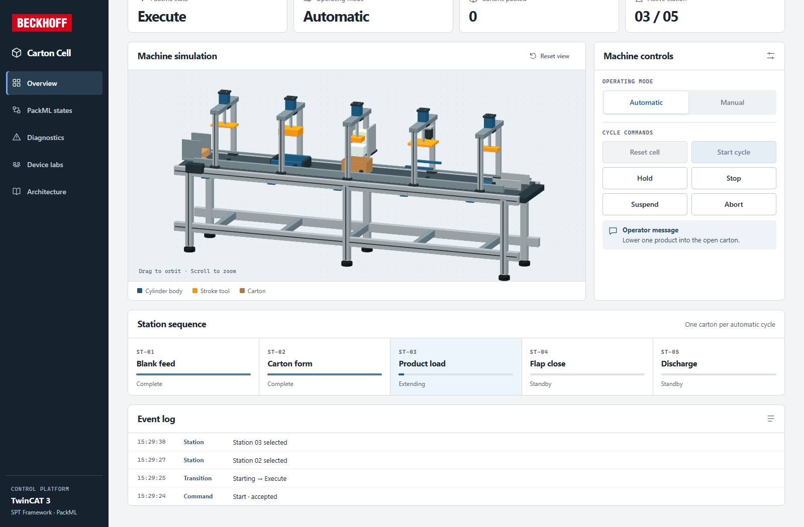
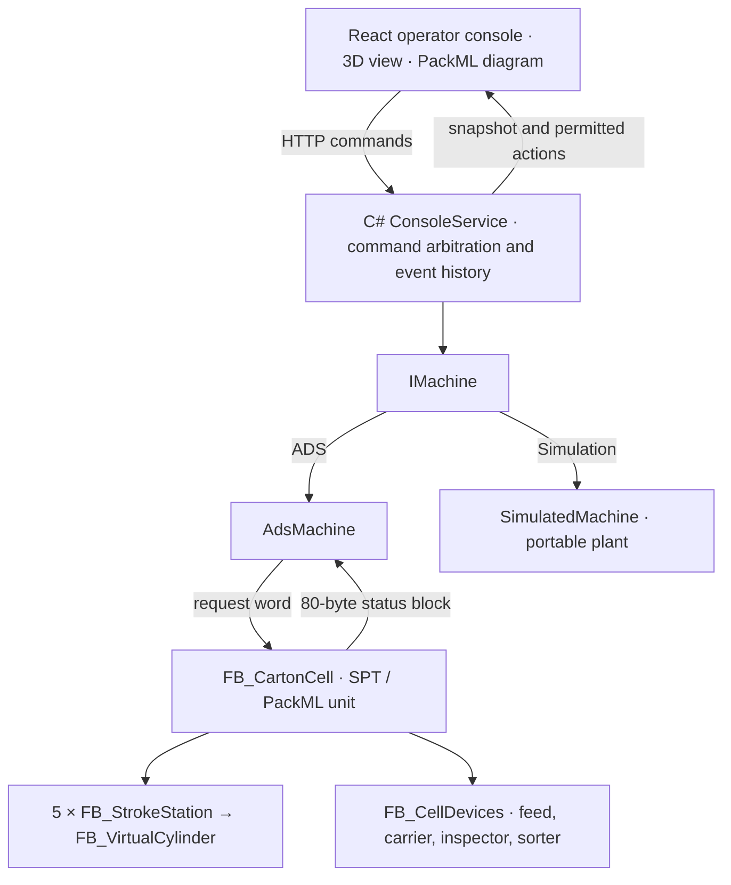
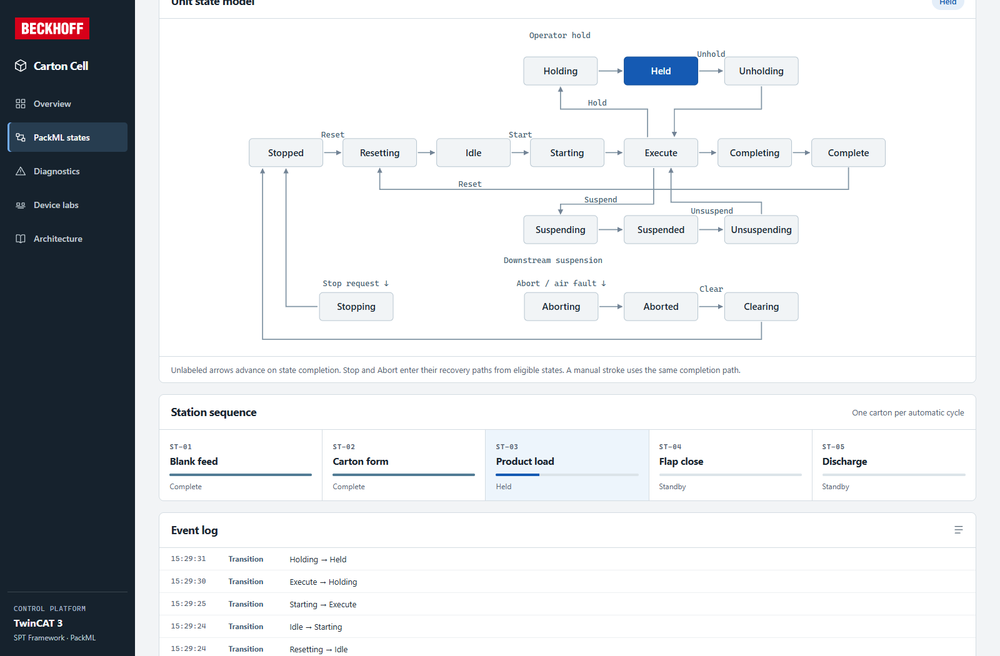
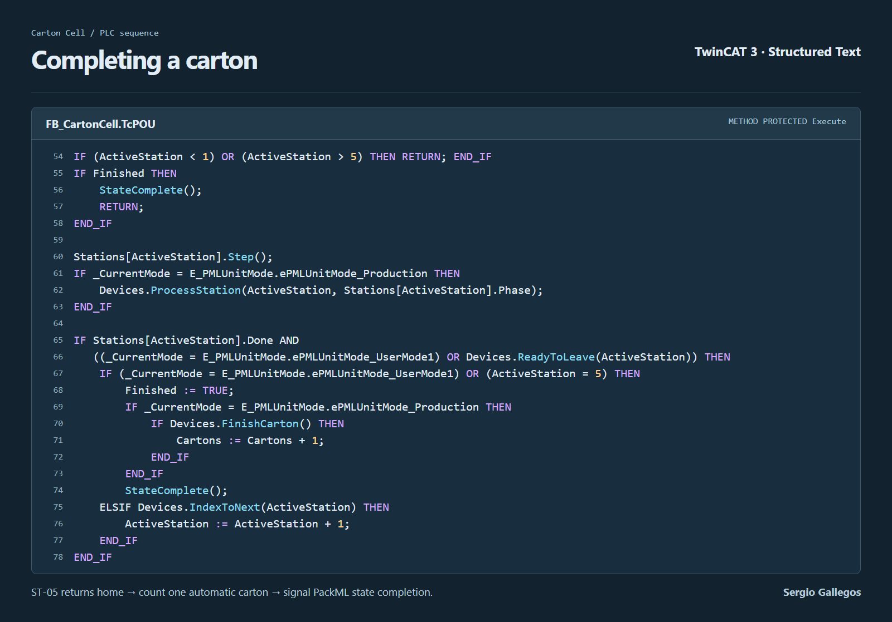
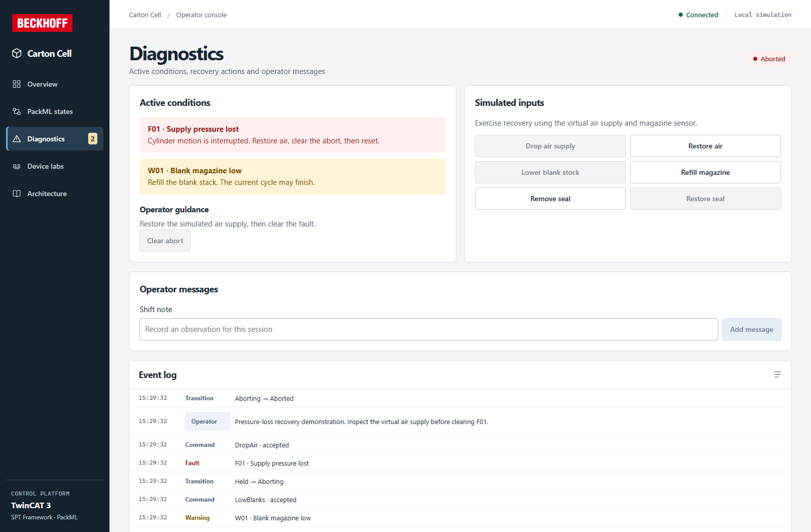
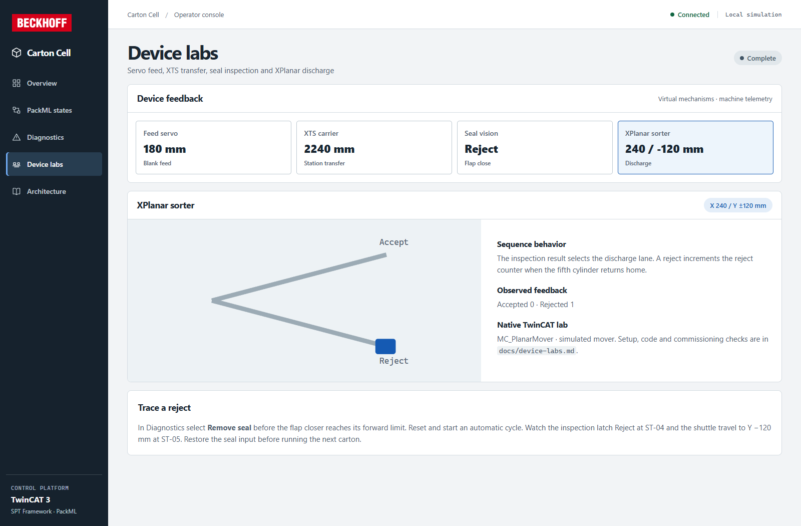

# Carton Cell

A hardware-free packaging-machine proof of concept by **Sergio Gallegos**. A servo meters a blank, an XTS carrier indexes it through five pneumatic stations, a seal inspection classifies the carton, and an XPlanar shuttle sorts it. A custom web HMI shows the machine pose, PackML transitions, operator guidance and production counts.

The reference implementation has two execution paths. A fresh clone runs a portable C# plant. With a TwinCAT target, the same HMI uses ADS and the PLC executes the SPT/PackML unit and virtual devices. Separate native labs exercise Beckhoff motion and vision APIs.



[Run locally](#run-the-simulation) · [Architecture](#software-architecture) · [Demonstration video](#demonstration-video)

## Objectives

- Demonstrate how SPT owns the PackML unit lifecycle while application function blocks own the machine sequence, station behavior and device feedback.
- Trace a command from a TypeScript UI through a C# service and ADS to the PLC, then trace the acknowledgment and physical-unit feedback back to the screen.
- Provide a reproducible commissioning exercise. A good seal and a missing seal produce different routes and independently verifiable counts.

## Technologies

| Layer | Implementation |
| --- | --- |
| Machine control | TwinCAT 3 Structured Text, SPT Base Types 3.9.0, Tc3_PackML_V2, 10 ms cyclic task |
| Device models | Servo feed, XTS indexing, five pneumatic tools, grayscale seal inspection, two-axis XPlanar sorter |
| HMI service | C#, .NET 10, ASP.NET Core, Beckhoff ADS .NET, typed machine adapters |
| Operator interface | React, strict TypeScript, Vite, Three.js, WebGL 2, Prettier |
| Mechanical design | Editable FreeCAD and Blender assemblies, glTF export, optional manufacturer STEP meshes |
| Verification | HTTP acceptance sequence, PLC/ADS contract checks, CAD and image-fixture checks, CI workflow |

## Software architecture



**Design decisions**

- **One owner of machine state.** In ADS mode, the PLC validates each request and advances the cycle. The browser moves the model from reported position feedback. Closing the browser leaves the machine sequence running.
- **One carton in flight.** This makes a complete product trace observable. A station remains selected until its cylinder is home and the next carrier position is confirmed. Manual mode isolates one station and preserves the production count.
- **A command has an identity.** One DINT contains its sequence and operation. The PLC echoes the consumed word. The HMI distinguishes submission, acknowledgment, state transition and process completion.
- **An inspection belongs to a carton.** The closing tool triggers the inspection once. Its latched result selects Y +120 mm or −120 mm and determines which counter advances at discharge.

[Architecture and extension guide](docs/architecture.md) · [Engineering walkthrough](docs/design-review.md) · [ADS wire contract](docs/ads.md)

## Run the simulation

Install **Git**, a **.NET 10 SDK**, **Node.js 22 with npm**, and a browser with WebGL 2. The first build needs package access. The built HMI serves the model and frontend assets locally. The default simulator can run without TwinCAT, FreeCAD or Blender.

```sh
git clone https://github.com/sergiogallegos/demo-twincat.git
cd demo-twincat
npm --prefix web ci
npm --prefix web run build
dotnet run --project server
```

Open [the local operator console](http://127.0.0.1:5080). Verify **Connected · Local simulation**, select **Reset cell**, wait for **Idle**, then select **Start cycle**. An automatic carton takes approximately thirteen seconds plus the PackML entry and completion transitions. Reset prepares the next carton. Ctrl+C stops the host.

| Exercise | What to do and observe |
| --- | --- |
| Hold or suspend | During Execute, select **Hold** or **Suspend**. Check the highlighted branch on **PackML states**. Resume or Unsuspend continues the interrupted stroke. |
| Manual control | Select **Stop**, wait for Stopped, switch to **Manual** and reset. Select a station and **Single stroke**. Only its cylinder moves. |
| Inspect and sort | In Diagnostics select **Remove seal** before the next cycle. In **Device labs**, observe Reject, zero bright samples and Y −120 mm. Restore the seal for the next carton. |
| Recover a fault | In Diagnostics select **Drop air supply**. F01 aborts the machine. **Restore air → Clear abort → Reset cell** returns it to Idle. |
| Warning and messages | Select **Lower blank stock**, add a shift note, then **Refill magazine**. Check the warning, note and recovery in the event log. |

For automated checks, start a fresh simulator, then run `python scripts/verify_contract.py` and `python scripts/smoke.py` from a second terminal. Python 3.10+ is sufficient.

## TwinCAT and native device labs

Open [CartonCell.sln](plc/CartonCell.sln) in XAE. The [commissioning guide](docs/commissioning.md) covers the pinned SPT checkout, library registration, XAR test target, TC1200 runtime, ADS route and startup sequence. The [native device labs](docs/device-labs.md) cover simulated NC axes, XTS, XPlanar mover feedback and a camera-free Vision File Source. They also include the workflow for five optional Beckhoff STEP components.

## Screenshots

| PackML hold path | PLC sequence |
| --- | --- |
| [](docs/images/packml-states.png) | [](docs/images/plc-sequence.png) |
| **Fault recovery** | **Inspection and routing** |
| [](docs/images/diagnostics.png) | [](docs/images/device-labs.png) |

[Architecture screen](docs/images/architecture.png) · [Full-resolution media](docs/images)

## Validation, limitations and next improvements

| Scope | Current evidence or boundary | Next improvement |
| --- | --- | --- |
| Portable machine and HMI | Automatic and manual cycles, hold/resume, suspension, fault recovery, both inspection routes and counters are exercised over HTTP. Desktop and mobile layouts were checked in a browser. | Add regression scenarios for additional product recipes and station faults. |
| PLC and ADS | The ADS adapter passed a local-router round trip against an isolated symbol server. It resolved both names, read the 80-byte block, wrote and acknowledged a command, and reacquired handles. Project structure and command IDs also have static checks. XAE compilation, download and live PLC commissioning remain acceptance items on the target installation. | Record a versioned XAE build and runtime trace with the same accept/reject sequence. |
| Device behavior | The core uses one virtual carrier, ideal end limits, bounded axis increments and two deterministic image fixtures. Native labs require their matching TwinCAT functions. | Add a native device adapter at a time and compare actual feedback, timeout and recovery behavior against the virtual plant. |
| HMI deployment | The host binds to loopback. Fault injection is enabled for teaching, and history is a 60-entry session buffer. | Add authenticated roles and persistent event storage before multi-operator deployment. |
| Mechanical model | The assemblies illustrate the process and signal mapping. Physical clearances, safety functions and performance require machine-specific validation. | Verify the mechanism and safety design against a selected physical configuration. |

## Repository guide

| Directory | Contents |
| --- | --- |
| [plc](plc) | TwinCAT system, PLC task, unit, stations and devices |
| [server](server) | ASP.NET Core host, ADS adapter, simulator and operator messages |
| [web](web) | HMI source, animated model, inspection fixtures and styling |
| [cad](cad) | Native FreeCAD and Blender files, shared geometry and exporters |
| [labs](labs) | Original native planar sorting and Vision inspection exercises |
| [tests/AdsLoopback](tests/AdsLoopback) | Repeat the ADS transport verification with a local router and an isolated test peer. |
| [scripts](scripts) | Contract and acceptance tests, native sample preparation and STEP retrieval |
| [docs](docs) | Setup, design rationale, interfaces, commissioning and review media |

[Contributor guide](CONTRIBUTING.md) · [MIT license](LICENSE) · [Vendor notices](NOTICES.md)

## Demonstration video

[**Watch or download the 76-second captioned walkthrough (MP4)**](docs/media/carton-cell-demo.mp4). The recording follows an automatic cycle, a PackML hold, the accept and reject lanes, an air-pressure fault and the engineering guide. It uses the running C# simulation and web HMI.

[](docs/media/carton-cell-demo.mp4)
# demo-twincat
