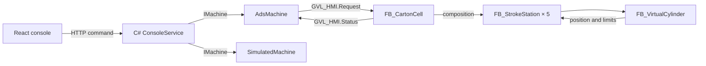

# Machine architecture

A carton is the unit of work. Automatic mode runs one carton per Start request. Manual mode exercises one selected station. Keeping one active carton makes state transitions, sensor feedback and cylinder motion observable from a single console.

## Read the project in execution order

1. The task calls [MAIN](../plc/CartonPLC/MAIN.TcPOU) every 10 ms. MAIN owns one cell instance. SPT initialization finishes before command processing begins.
2. [FB_CartonCell](../plc/CartonPLC/FB_CartonCell.TcPOU) samples the request, rechecks state/mode permissives, then calls the SPT base implementation. SPT and its PackML state machine dispatch the active state callback. This is the **Template Method** pattern.
3. During Execute, the unit calls one [station](../plc/CartonPLC/FB_StrokeStation.TcPOU). Each station owns a [cylinder](../plc/CartonPLC/FB_VirtualCylinder.TcPOU). This is **composition**. The cylinder owns position. The station decides when to reverse and when its cycle is complete. The machine owns station order and the carton count.
4. One outstroke takes 100 scans. The station reverses on the forward limit and completes on the home limit. The unit advances after home confirmation. A finished latch prevents duplicate counting while PackML acknowledges completion.
5. The service selects an [ADS adapter](../server/AdsMachine.cs) or [portable simulator](../server/SimulatedMachine.cs) through [IMachine](../server/Machine.cs). This is the **Adapter** pattern with dependency injection. HTTP and the HMI present the same contract in both cases.
6. [The connection hook](../web/src/useConsole.ts) polls snapshots in order. The 3D view uses the reported station and phase to update the rod, tool and carton. The browser owns the camera. The machine owns time and position.

## Operation and state ownership

| Operation | Owner | Behavior |
| --- | --- | --- |
| Automatic | PackML Production, mode 1 | Reset brings the machine to Idle. Start runs all five stations. The discharge home limit accounts for one carton in the accept or reject counter. |
| Manual station test | Application-defined PackML unit mode 4 | The unit registers a manual stroke profile with Idle and Complete enabled. Change modes while Stopped. Reset, select a station, then run one stroke. |
| Hold / Suspend | Machine unit | Hold represents an operator interruption. Suspend represents an external line condition. Both preserve station and position. Resume returns to Execute. |
| Stop / Abort | Machine unit | Motion freezes. Reset discards the interrupted virtual carton and homes the stations. |
| F01 pressure loss | Virtual input and machine unit | Aborts the cycle. Restore air before Clear, then Reset. |
| W01 low blank stock | Virtual input and machine unit | Warns while the current carton can continue. Refill clears the warning. |
| Operator messages | Local C# host | Shows state-dependent guidance. Shift notes, source changes, warnings, faults and observed state transitions share a 60-entry in-memory event log. |

The transport advances up to 8 mm per 10 ms scan and takes 70 scans per 560 mm pitch. The unit holds the current station until the mover reaches the next nest. At ST-04 forward limit, the inspector latches a pass or reject result. At ST-05 the shuttle advances toward X 240 mm and Y +120 mm for accept or −120 mm for reject. The cylinder home limit completes accounting. Manual strokes bypass linked transport and inspection. The CAD represents the demonstration mechanism. Real indexing, guarding, pressure monitoring, actuator timeouts, safe motion and physical I/O require machine-specific engineering.

## Extension exercise

**Add a weight check before discharge.** Give the weighing station a completion condition, such as a stable weight reading after the carrier settles. Preserve the station contract so the unit continues to call Step and observe Done. Give the new process its own function block when its behavior differs from a cylinder stroke. Instantiate it in the unit and route its success or rejection explicitly.

Change the sequence length and the point that counts a finished carton. Add the station’s name and visual mapping to the HMI, update the geometry and mirror the behavior in the portable simulator. Change the command and status bounds together wherever station numbers are validated. Introduce a new protocol signature if existing clients would interpret an old word differently. Extend the automatic and manual acceptance checks before adding physical I/O.

## Design of the operator interface

A fixed navigation rail keeps Overview, PackML states, Diagnostics and Architecture accessible. The working surface is light with neutral chrome, labeled status indications and touch targets of at least 44 pixels. Blue identifies interactive controls, green indicates healthy operation, amber indicates a warning and red indicates an alarm. The vendor wordmark has a dedicated brand region. Every condition has text and an action the operator can take.
