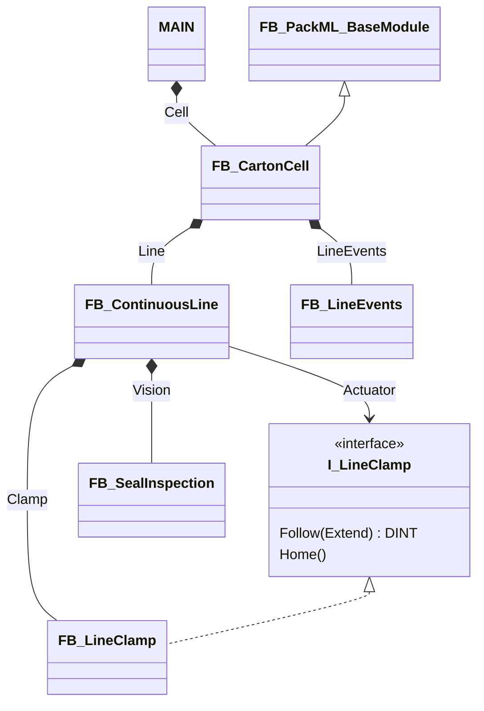
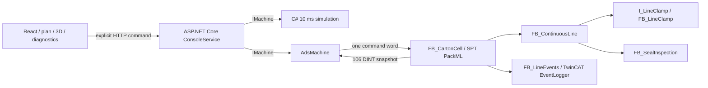
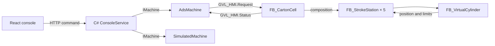

# Machine architecture

## What this proof of concept answers

A machine builder can trace a specific requirement across disciplines. A carton must arrive at inspection with the same ID and assembly results that it had at transfer. The mechanical layout establishes the handoff location, the PLC design defines its permissives, and the web console exposes the ID and masks on each mover. The portable simulation makes the sequence repeatable before equipment selection. The engineer can inject a missing seal or a stuck clamp and observe two different decisions, product rejection and machine abort.

## Continuous-line PLC objects

**Trace ST-03.** On an executing scan, the unit calls `Line.Step()`. The line assigns its clamp instance to the `Actuator` interface, requests extension and reads back the simulated position. The loaded carton receives its station check after the required limit is observed. If the limit stays missing for 15 executing scans, F02 records an occurrence. The unit requests Abort, publishes status and passes the alarm state to its EventLogger block. Acknowledging an occurrence and correcting the obstruction are separate actions. [Unit](../plc/CartonPLC/FB_CartonCell.TcPOU) · [Line](../plc/CartonPLC/FB_ContinuousLine.TcPOU) · [Clamp](../plc/CartonPLC/FB_LineClamp.TcPOU)

## Continuous production

The XTS carts, paired servo axes and XPlanar movers are application data in the main cell. For example, the PLC line model computes each station’s X and Z positions in `CamX` and `CamZ` and publishes them to the HMI. These values can be traced in the PLC source even though the XAE motion tree contains no configured axes. [Continuous-line function block](../plc/CartonPLC/FB_ContinuousLine.TcPOU)

SPT owns state dispatch. The unit samples the ADS request once, checks machine permissives, and calls the line during automatic Execute. The portable implementation follows the same integer scan law. Simulated mover identities stay fixed in both arrays. A master index advances modulo 30 so ten loop carts and six planar movers return to their starting arrangement together. Hold/Suspend stop the master. Stop freezes the work. Reset removes in-flight cartons, records discards, and keeps issued IDs and final counts.

| Location | Process and evidence |
| --- | --- |
| XTS 01–04, first straight | Feed blank, form tray, seat insert under clamp, load base. At commanded depth each loaded station latches its assembly check. ST-03 also requires the 16 mm forward limit. |
| XTS 05–08, return straight | Fit module, insert leaflet while tracking, close lid, lift to planar pickup. The handoff requires a loaded source and an empty receiving mover. |
| Planar 01 | Check that all eight assembly confirmations arrived with the carton. |
| Planar 02 | Sample the five grayscale fixture points through the seal-inspection model. Four bright samples pass. Store the result on this carton. |
| Planar 03 | Pack or reject, record the last ID and masks, then clear the payload on this mover. The other two positions return empty movers to pickup. |

A shared master divides one pitch into a station dwell and a 40% transport interval. The teaching cam uses cubic smoothstep with zero velocity at both ends. Seven pairs reach, lower, withdraw and return during dwell. ST-06 gears its longitudinal axis 1:1 to a 500 mm moving pitch over the first half of travel, inserts at speed, then returns. Both recipes use 200 scans per pitch (2 s). Standard uses 40 mm Z travel and Precision uses 48 mm. Ideal followers report their computed positions. Servo lag, inertia, collisions and independent traffic planning are separate native commissioning exercises.

F02 compares a clamp request with observed extension for 15 executing scans. Pressure loss remains a separate F01. A missed assembly or seal check routes a product to rejection. A missing actuator limit aborts the machine. The browser sends the displayed occurrence ID when acknowledging F02. The service and PLC both reject a stale occurrence. Native EventLogger receives raise, confirmation, clearance and reset events. The HMI's occurrence history timestamps the service observations and retains the newest 128 F02 entries per host session.

### Production metrics and performance

Planned time starts at Run, includes Holds, suspension and fault recovery, and ends at an explicit Stop or departure from the profile. Running time accumulates during Execute. Availability = running / planned. Performance = sum of ideal pitch times for all discharged cartons / running. Quality = good / discharged. OEE is the product. Empty denominators display a dash. These are cumulative demo-session metrics. Pipeline fill lowers performance, and Reset discards are reported separately. The HMI scope samples the host snapshot and is suitable for observing the cam relationship; PLC scan traces require TwinCAT Scope.

### Extension boundaries

The reusable parts include carton identity, the inspection bit meanings, PackML transition intent and the HMI contract. The transport model must be bound to configured XTS and XPlanar axes, route reservations, arrival feedback and device faults. The ST-06 flying insertion needs a real master reference, configured gearing or cams, and measured following error. A commissioned vision station needs camera triggering, calibrated illumination and acceptance images. Safeguarding, I/O fault behavior, load sizing and tool clearance require machine-specific validation. The task board records the local PLC build, ADS commissioning results and remaining field tests. [Commissioning](commissioning.md) · [Task board](board.md)

A field clamp can implement the same Follow and Home interface using mapped demand and end-limit inputs. The NC adapter would supply measured axis feedback in place of the integer cam positions. The vision lab can supply a verdict and sample count from a File Source. The HMI consumes only the selected machine snapshot. Report writers, SQL consumers and future read-only ML or C++ observers belong outside the real-time command path.

## Single-carton teaching bench
A carton is the unit of work. The bench automatic profile runs one carton per Start request. Manual mode exercises one selected station. Keeping one active carton makes state transitions, sensor feedback and cylinder motion observable from a single console.

### Read the bench project in execution order

1. The task calls [MAIN](../plc/CartonPLC/MAIN.TcPOU) every 10 ms. MAIN owns one cell instance and calls its RunScan method. RunScan completes SPT initialization before dispatching cyclic command processing.
2. [FB_CartonCell](../plc/CartonPLC/FB_CartonCell.TcPOU) samples the request, rechecks state/mode permissives, then calls the SPT base implementation. SPT and its PackML state machine dispatch the active state callback. This is the **Template Method** pattern.
3. During Execute, the unit calls one [station](../plc/CartonPLC/FB_StrokeStation.TcPOU). Each station owns a [cylinder](../plc/CartonPLC/FB_VirtualCylinder.TcPOU). This is **composition**. The cylinder owns position. The station decides when to reverse and when its cycle is complete. The machine owns station order and the carton count.
4. One outstroke takes 100 scans. The station reverses on the forward limit and completes on the home limit. The unit advances after home confirmation. A finished latch prevents duplicate counting while PackML acknowledges completion.
5. The service selects an [ADS adapter](../server/AdsMachine.cs) or [portable simulator](../server/SimulatedMachine.cs) through [IMachine](../server/Machine.cs). This is the **Adapter** pattern with dependency injection. HTTP and the HMI present the same contract in both cases.
6. [The connection hook](../web/src/useConsole.ts) polls snapshots in order. The 3D view uses the reported station and phase to update the rod, tool and carton. The browser owns the camera. The machine owns time and position.

## Operation and state ownership

| Operation | Owner | Behavior |
| --- | --- | --- |
| Automatic | PackML Production, mode 1 | Reset brings the machine to Idle. Start runs all five stations. The discharge home limit accounts for one carton in the accept or reject counter. |
| Manual station test | Application-defined PackML unit mode 4 | The unit registers a manual stroke profile with Idle and Complete enabled. Change modes while Stopped. Reset, select a station, then run one stroke. |
| Hold / Suspend | Machine unit | Hold represents an operator interruption. Suspend represents an external line condition. Both preserve station and position. Resume returns to Execute. |
| Stop / Abort | Machine unit | Motion freezes. Reset discards the interrupted virtual carton and homes the stations. |
| F01 pressure loss | Virtual input and machine unit | Aborts the cycle. Restore air before Clear, then Reset. |
| W01 low blank stock | Virtual input and machine unit | Warns while the current carton can continue. Refill clears the warning. |
| Operator messages | Local C# host | Shows state-dependent guidance. Shift notes, source changes, warnings, faults and observed state transitions share a 60-entry in-memory event log. |

The transport advances up to 8 mm per 10 ms scan and takes 70 scans per 560 mm pitch. The unit holds the current station until the mover reaches the next nest. At ST-04 forward limit, the inspector latches a pass or reject result. At ST-05 the shuttle advances toward X 240 mm and Y +120 mm for accept or −120 mm for reject. The cylinder home limit completes accounting. Manual strokes bypass linked transport and inspection. The CAD represents the demonstration mechanism. Real indexing, guarding, pressure monitoring, actuator timeouts, safe motion and physical I/O require machine-specific engineering.

## Extension exercise

**Add a weight check before discharge.** Give the weighing station a completion condition, such as a stable weight reading after the carrier settles. Preserve the station contract so the unit continues to call Step and observe Done. Give the new process its own function block when its behavior differs from a cylinder stroke. Instantiate it in the unit and route its success or rejection explicitly.

Change the sequence length and the point that counts a finished carton. Add the station’s name and visual mapping to the HMI, update the geometry and mirror the behavior in the portable simulator. Change the command and status bounds together wherever station numbers are validated. Introduce a new protocol signature if existing clients would interpret an old word differently. Extend the automatic and manual acceptance checks before adding physical I/O.

## Design of the operator interface

A white navigation rail, persistent live status header and bottom machine command dock frame the scrollable working surface. The header shows PackML state, mode, alerts, source and production counts on every tab. The navigation rail keeps Overview, PackML states, Diagnostics and Architecture accessible. The working surface is light with neutral chrome, labeled status indications and touch targets of at least 44 pixels. Blue identifies interactive controls, green indicates healthy operation, amber indicates a warning and red indicates an alarm. The vendor wordmark has a dedicated brand region. Every condition has text and an action the operator can take.
